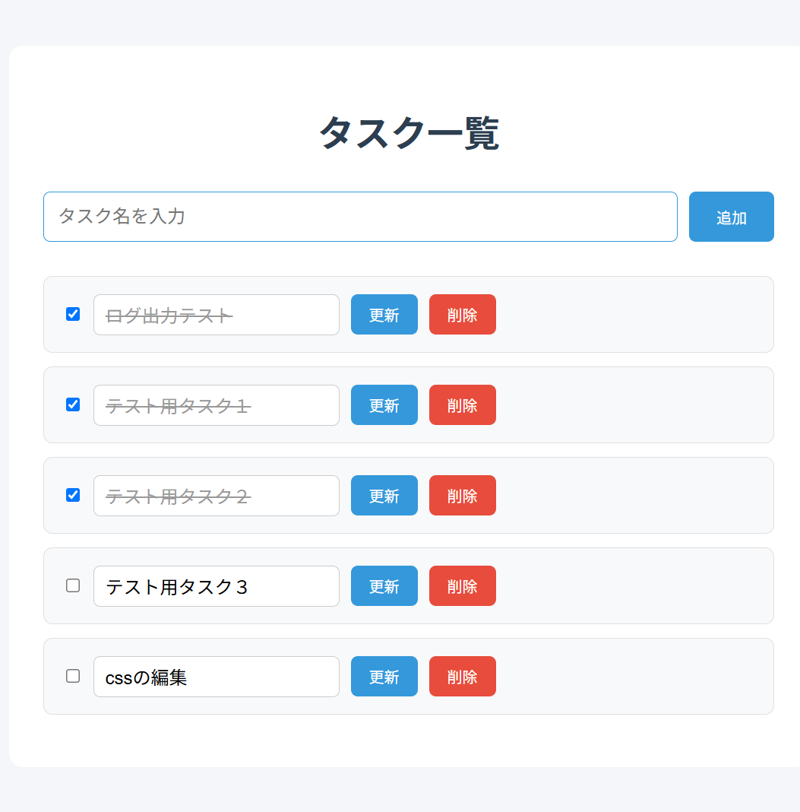

# タスク管理アプリ

Spring Bootを使用して作成した、タスクを管理するWebアプリケーションです。

タスクの追加・編集・削除・完了状態の変更を行うことができます。

## 使用技術

- Java 21
- Spring Boot 4.1.2
- Spring Data JPA
- Thymeleaf
- H2 Database
- HTML / CSS
- JUnit 5
- Git / GitHub

## 主な機能

- タスクの新規登録
- 登録したタスクの一覧表示
- タスク名の編集
- タスクの削除
- タスクの完了・未完了の切り替え
- タスク名の未入力チェック
- 存在しないタスクへの操作に対する例外処理

## 画面イメージ



## 起動方法

### 1. リポジトリをクローン

```bash
git clone https://github.com/kurugemo/spring-boot-task-manager.git
```

### 2. プロジェクトのディレクトリに移動

```bash
cd spring-boot-task-manager
```

### 3. アプリケーションを起動

Windowsのコマンドプロンプトの場合：

```cmd
mvnw.cmd spring-boot:run
```
Git Bashの場合：

```bash
./mvnw.cmd spring-boot:run
```

### 4. ブラウザでアクセス

http://localhost:8080/tasks

## テスト方法

以下のコマンドでJUnitテストを実行できます。

Windowsのコマンドプロンプトの場合：

```cmd
mvnw.cmd test
```

Git Bashの場合：

```bash
./mvnw.cmd test
```
